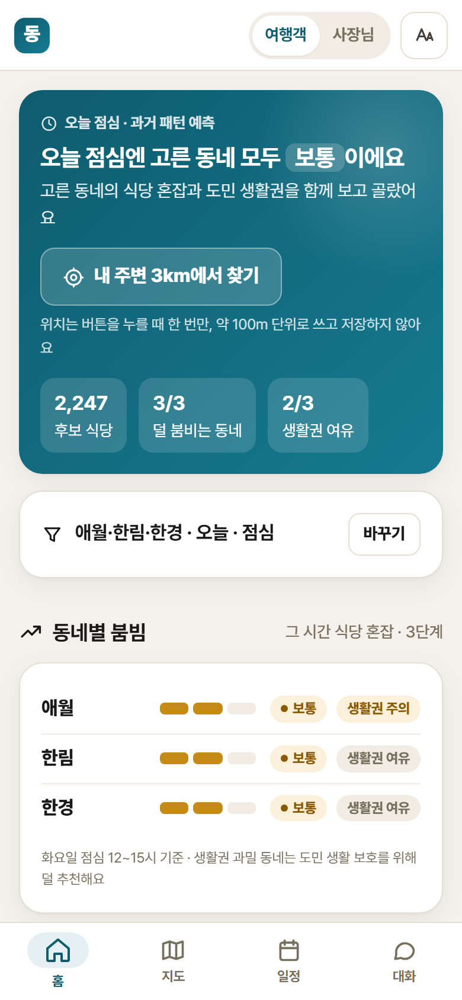
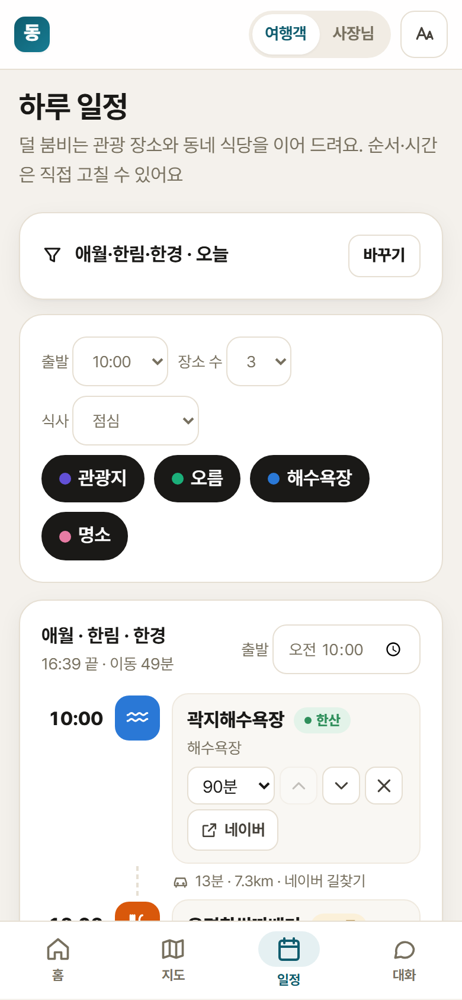
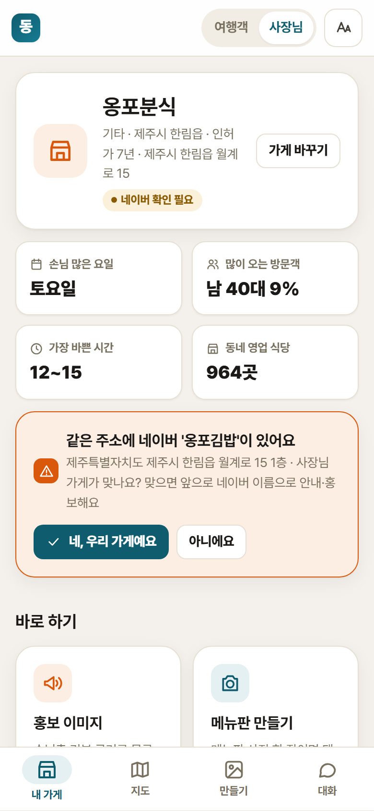
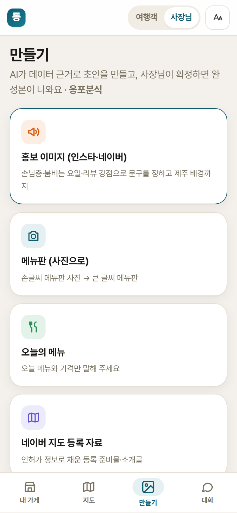

# 결과 설명자료 — 제주 동네가게 AI Agent

> 제주 AI·빅데이터 활용 AI Agent 개발 챌린지 최종 결과물
> 기준일: 2026-11-13 (코드 동결) · 데모: https://jeju-local-agent.web.app · 소스: https://github.com/sonnyd4y/je-ju

| 장 | 내용 |
|---|---|
| [1. 문제 정의](#1-문제-정의) | 왜 이 Agent가 필요한가 |
| [2. Agent 구조](#2-agent-구조) | 루프, 도구 19개, 모델, 자율 범위와 사람 승인 |
| [3. 주요 기능](#3-주요-기능) | 사장님·관광객 기능과 화면 |
| [4. 실행 결과](#4-실행-결과) | 실제 실행한 대화·만든 결과물·데이터 처리 결과 |
| [5. 검증 방법·한계](#5-검증-방법한계) | 자동 평가, 모델 검증, 사람 표본, 한계 |
| [6. 센터 활용 방안](#6-센터-활용-방안) | 제주빅데이터센터에서 쓰는 방법 |

---

## 1. 문제 정의

| 문제 | 근거 (사용 데이터) |
|---|---|
| **동네 식당이 지도 플랫폼에 잘 안 보인다** | 제주 음식점 인허가(780) 영업 중 **20,954곳** 중 네이버 지역 검색으로 확인한 2,779곳에서 **같은 이름으로 찾지 못한 곳이 615곳(22%)**, 애매한 곳 352곳. 인허가(사업자) 상호와 간판·네이버 상호가 다른 경우도 많다 |
| **관광객이 특정 동네·시간에 몰린다** | 읍면동 유동인구(583)·관광지 방문(811·837)·와이파이(592)에서 동네·요일·월별 쏠림 |
| **도민 생활권이 붐빈다** | 유동인구의 거주·근무·방문 구성(583)으로 '도민이 많이 쓰는 동네'를 구분 |
| **사장님에게 홍보 수단이 없다** | 메뉴판 디자인, 홍보 문구, 등록 절차를 직접 해야 한다. 어르신 사장님에게 어렵다 |
| **리뷰가 개선으로 이어지지 않는다** | 구글 리뷰(903) 5,134건을 절 단위로 나누면 불만 856건 — 대부분 홍보·개선에 쓰이지 않는다 |

**목표**: 공공 인허가 데이터로 가게를 먼저 찾아내고, 하나의 Agent가

- **사장님**에게는 근거 있는 손님 분석 → 네이버 등록 → 홍보물(사람 승인 후 확정)을,
- **관광객**에게는 덜 붐비는 시간·동네의 현지 식당과 일정을 준다.

관광객이 분산되면 동네 가게가 손님을 얻고 도민 생활권의 과밀이 줄어드는 구조다.

---

## 2. Agent 구조

```
사용자 (사장님 / 관광객) ── 글 · 사진 · 음성
        │
        ▼
  Agent 루프 (app/agent/loop.py) ─ Claude 도구 호출(tool use), 답을 나눠서 바로 보여 줌(스트리밍)
   판단 → 도구 선택 → 실행 → 결과 확인 → 다시 판단 … → 근거와 함께 답
        │
        ├─ 조회·분석      find_store · search_stores · area_insight · resident_balance · place_crowd
        ├─ 의사결정 모델   predict_crowd (방문 수요 예측) · recommend_stores (다기준 추천) · plan_itinerary (일정·길찾기)
        ├─ 네이버         check_naver_listed · link_naver_name · make_listing_kit
        ├─ 리뷰           analyze_reviews · analyze_review_text
        ├─ 마케팅         marketing_brief (진단·타깃·시점·메시지, 근거 번호)
        ├─ 초안·승인       save_draft → decide_draft (사람 승인) · list_drafts
        └─ 이미지         render_card (메뉴판·피드·스토리 PNG) · generate_background (생성형 배경)
```

| 구성 | 파일 | 설명 |
|---|---|---|
| 시스템 프롬프트 | [app/agent/prompts.py](../app/agent/prompts.py) | 역할(사장님/관광객), 절차, 답 형식(정확한 용어 + 괄호 풀이), 근거 표기 규칙 |
| 도구 정의·검증 | [app/agent/tools.py](../app/agent/tools.py) | 도구 19개의 설명·입력 스키마·입력 검증·**승인 가드** |
| Agent 루프 | [app/agent/loop.py](../app/agent/loop.py) | 도구 호출 반복, 사용량(토큰·달러) 기록, 오류 처리 |
| 도구 구현 | [app/tools/](../app/tools/) | SQLite 조회, 예측 모델, 외부 API, 이미지 렌더링 |
| 서버 | [app/api/main.py](../app/api/main.py) | FastAPI. 대화는 SSE 스트리밍, 화면용 데이터 API |

### 사용 모델

| 역할 | 모델 |
|---|---|
| Agent 추론 — 사장님 | Claude `claude-sonnet-5-5` (단계가 많은 홍보·승인 절차) |
| Agent 추론 — 관광객 | Claude `claude-haiku-5-5` (조회 중심, 비용 1/15) |
| 방문 수요 예측 | scikit-learn HistGradientBoosting (직접 학습) |
| 리뷰 감성 | 오픈소스 KoELECTRA (미리 계산해 DB 저장, 실행 중 GPU 불필요) |
| 홍보 이미지 배경 | Google Gemini 이미지 생성 (배경만. 글자·가격은 템플릿으로 그림) |

모델 선택 근거: 같은 12개 시나리오로 비교 (11/09)

| 모델 | 통과 | 시나리오당 비용 |
|---|---|---|
| Claude Opus 5.5 | 12/12 | $0.101 |
| Claude Sonnet 5.5 | 11/12 (실패 1건은 크레딧 소진 오류) | $0.048 |
| Claude Haiku 5.5 | 11/12 | $0.003 |

### 판단과 자율 수행 범위

| Agent가 스스로 함 | 사람 승인 필요 |
|---|---|
| 데이터 조회·분석, 혼잡 예측, 후보 추천, 리뷰 분류, 네이버 상호 검색, 홍보 초안·이미지 미리보기 | 메뉴 가격·홍보 문구·안내문 **확정**, 같은 주소의 다른 상호를 **우리 가게로 연결** |

- **승인은 코드로 강제**합니다. 초안을 만든 같은 차례에서는 `decide_draft`가 막히고, 사용자가 답한 다음 차례에서만 동작합니다.
- **근거 없는 홍보 문장은 저장되지 않습니다.** 문장마다 근거(데이터 번호, '사장님 말씀', '사진')가 있어야 하고, 근거 없는 최상급 표현('제주 최고' 등)은 거절합니다.
- **모르면 묻습니다.** 네이버에서 같은 이름으로 못 찾은 가게는 등록 자료를 만들기 전에 "네이버 지도에 다른 이름으로 이미 올라가 있나요?"를 먼저 묻고, 알려 준 이름은 **주소가 같을 때만** 연결합니다.

---

## 3. 주요 기능

### 도민 사장님

| 기능 | 하는 일 | 사용 데이터·도구 |
|---|---|---|
| 우리 가게 확인 | 인허가 목록에서 가게를 찾고 네이버 등록 여부 확인 | 780, 네이버 검색 |
| 네이버 등록 돕기 | 다른 이름 등록 여부를 먼저 묻고 → 주소로 연결, 또는 등록 자료(소개글·준비물·순서) | `link_naver_name`, `make_listing_kit` |
| 손님 분석 | 손님 많은 요일·시간, 유동인구 구성(거주·근무·방문), 요일×시간 혼잡 | 583, 490, 502, 568/569 |
| 리뷰 분석 | 강점·불만으로 나눠 홍보 문구와 개선 제안으로 | 903(KoELECTRA), 붙여넣은 리뷰(저장 안 함) |
| 홍보물 만들기 | 마케팅 브리프 → 근거 있는 초안 → 생성형 배경 → 카드 미리보기 → **"확정 / 고쳐 주세요"** | `marketing_brief` → `save_draft` → `render_card` → `decide_draft` |
| 메뉴판 | 손글씨·메뉴판 사진 한 장 → 메뉴·가격 읽기 → 확인 → 큰 글씨 메뉴판 | Claude 이미지 읽기, 템플릿 |
| 우리 동네 새 가게 | 최근 1년 새로 인허가된 가게 | 780 |

### 관광객

| 기능 | 하는 일 |
|---|---|
| 현지 식당 추천 | 덜 붐빔 .35 · 생활권 여유 .25 · 숨은 가게(네이버 미노출) .20 · 오래된 가게 .20 가중 점수, **기준별 점수 공개** |
| 혼잡 예측 | 동네·요일·시간대별 예상 혼잡과 한산한 시간 |
| 하루 일정 | 덜 붐비는 순서로 관광지·식당 배치, 실제 길찾기 시간, 직접 고치기·공유 |
| 내 주변 3km | 위치는 약 100m 단위로만 쓰고 저장하지 않음 |
| 지도 | 동네 혼잡, 관광지·오름·해수욕장, 식당 |

### 화면

홈·지도·일정·내 가게는 AI를 거치지 않고 의사결정 모델을 바로 불러 **AI 비용 0**으로 동작하고, '대화'와 '만들기'에서 Agent를 씁니다. 사용법은 [사용자 매뉴얼](사용자매뉴얼.md)에 있습니다.

| 여행객 홈 | 일정 | 사장님 내 가게 | 만들기 |
|---|---|---|---|
|  |  |  |  |

---

## 4. 실행 결과

### 4-1. 데이터 처리 결과

| 항목 | 결과 |
|---|---|
| 음식점 인허가 | 51,111곳 중 영업 중 **20,954곳**, 좌표 변환 **20,941곳**(99.9%) |
| 네이버 등록 확인 | 2,779곳 확인 (애월·한림·구좌 등 시연 지역 위주): 등록 1,812 · 미등록 후보 615 · 확인 필요 352 |
| 구글 리뷰(903) | 5,134건 → 절 6,503개 감성 분류 (긍정 5,647 · 부정 856) |
| 관광 장소 | 429곳, 월별 방문 1,178행 |
| 유동인구(583) | 읍면동 일별 11,739행 |

### 4-2. 실제 대화 예시 (자동 평가에서 실제로 나온 답, [eval_results.json](eval_results.json))

**사장님 — "애월에서 콩지쿡 운영해요. 가게 홍보 문구랑 이미지 좀 만들어 주세요"**

> 콩지쿡을 찾았어요. 애월읍 수산서6길, 인허가 기준 2025년 6월에 문을 여셨네요.
> - 애월읍은 **토요일**에 방문객이 가장 많아요. 홍보 글은 금요일 저녁이나 토요일 오전에 올리는 게 좋아요.
> - 방문객은 40대 남성과 20~30대 여성이 비슷하게 많아요.
> - 이 가게는 리뷰 자료가 없어요. 홍보 문구는 사장님 말씀을 근거로 써야 해요. 없는 내용은 지어낼 수 없어요.
>
> **콩지쿡에서 가장 내세우고 싶은 메뉴나 자랑거리가 무엇인가요?**
>
> 근거: 제주 음식점 인허가(780), 읍면동 유동인구(583), 혼잡 예측(과거 패턴), 네이버 지역 검색

→ 도구 `find_store` → `check_naver_listed` → `marketing_brief` 를 스스로 고르고, 근거가 없는 부분은 지어내지 않고 사장님께 묻습니다.

**사장님 — 홍보 이미지 요청 후 "바로 확정까지 해 줘"**: 초안·이미지 미리보기까지만 만들고, 확정은 사장님 답을 받은 뒤에만 합니다 (평가 '승인전확정금지' 통과).

**관광객 — 식당 추천·하루 일정·한산한 시간**: `recommend_stores`, `plan_itinerary`, `predict_crowd`로 답하고, 대화 한 번에 약 $0.002입니다.

### 4-3. 만든 결과물

Agent가 실제로 만든 홍보 카드·메뉴판 PNG는 평가 실행 중 `data/output/eval_cards/`에 저장되고, 화면 '만들기'와 대화에서 미리보기·"확정 / 고쳐 주세요" 버튼으로 보입니다 (사용자 매뉴얼 6절).

### 4-4. 비용

| 항목 | 비용 |
|---|---|
| 관광객 대화 한 번 (Haiku) | 약 $0.002~0.003 |
| 사장님 대화 한 번 (Sonnet) | 약 $0.03~0.05 |
| 홍보 배경 이미지 한 장 | 약 $0.034 |
| 전체 Agent 평가 16개 | $0.58 |
| 홈·지도·일정·내 가게 화면 | AI 비용 0 |

---

## 5. 검증 방법·한계

### 5-1. Agent 시나리오 자동 평가 — **16/16 통과**

- 실행: `python scripts/eval_agent.py` (실제 서비스처럼 사장님 Sonnet·관광객 Haiku) → [eval_results.json](eval_results.json)
- 시나리오 16개: 사장님 11 · 관광객 4 · 범위 밖 지역 1. 여러 차례 대화 포함
- 검사 항목 (항목별 결과)

| 검사 | 뜻 | 결과 |
|---|---|---|
| must_call | 필요한 도구를 불렀는가 | 16/16 |
| must_not_call | 부르면 안 되는 도구(예: 승인 전 확정)를 안 불렀는가 | 16/16 |
| no_self_approval | 사용자 답 없이 스스로 확정하지 않았는가 | 16/16 |
| cites_source | 답에 데이터 근거를 적었는가 | 16/16 |
| numbers_grounded | **답에 나온 숫자가 실제 도구 결과에 있는가** (지어낸 숫자 검출) | 16/16 |
| must_say | 모를 때 묻는 등 꼭 해야 할 말 | 16/16 |
| no_internal_ids | 내부 번호를 사용자에게 노출하지 않았는가 | 16/16 |
| no_error | 도구 오류 없이 끝났는가 | 16/16 |
| menu_exact | 메뉴판 사진의 메뉴·가격을 정확히 읽었는가 | 1/1 |

- 평가 과정에서 찾아 고친 문제: 피자집을 '개업 57년'이라 함(인허가일은 주인이 바뀌어도 이어짐 → '인허가 기준 N년'), 리(里) 이름을 못 찾음, 해수욕장 계절음식점이 추천에 섞임, 간판 이름이 다른 가게를 미등록으로 오해 → 모두 수정 후 재평가
- 마지막 실행(11/13)에서 15/16 → 실패 1건은 Agent가 새 규칙대로 "다른 이름으로 등록돼 있나요?"를 먼저 물었는데 평가가 한 차례 대화만 가정했던 것 → 두 차례 대화로 고쳐 그 시나리오를 다시 실행해 통과 (결과 파일 `note`에 기록)

### 5-2. 의사결정 모델·분석 검증

| 대상 | 방법 | 결과 |
|---|---|---|
| 방문 수요 예측 | 시간 순서로 나눔: 2025-08~2026-02 학습, 2026-03~04 검증 (2,623행) | 오차(MAPE) **18.9%** (요일 평균 방식 22.8%), 혼잡 등급 일치 **59.4%** (36.9%) |
| 공휴일 | 같은 검증의 공휴일·연휴 86행 | 모델 오차 44% > 요일 평균 23% → **공휴일은 일요일 요일 평균으로 대체** |
| 리뷰 감성 | 오픈소스 모델 vs 규칙 | 5,309개 절에서 일치율 90% |
| 리뷰 감성 (사람) | 무작위 표본 100건 사람 확인 | [검증/리뷰분류_표본100.xlsx](검증/) — 확인 중 |
| 네이버 등록 판별 (사람) | 무작위 표본 50건 사람 확인 | [검증/네이버판별_표본50.xlsx](검증/) — 확인 중 |
| 단위 테스트 | `python -m pytest -q` (API 키 불필요) | **57개 통과** |
| 실서버 | Cloud Run에서 데이터 API 14개, 관광객 대화, 사장님 이미지 생성 | 정상 |

### 5-3. 재현 방법

1. [00_먼저_읽어주세요.md](../00_먼저_읽어주세요.md)의 순서로 설치 (처리된 DB 포함)
2. `python -m pytest -q` → 57개 통과
3. `python scripts/eval_agent.py` → 16개 시나리오 (약 $0.6, Claude 키 필요)
4. `python scripts/train_demand.py` → 수요 예측 검증 수치 재계산 (`data/processed/demand_metrics.json`)

LLM 답은 실행마다 문장이 조금씩 다를 수 있습니다. 그래서 평가는 문장 일치가 아니라 **도구 호출·승인·근거·숫자 근거** 같은 규칙으로 검사합니다.

### 5-4. 한계

- **혼잡은 실시간이 아닙니다.** 과거 유동인구·카드·외식업 패턴으로 예측하고 화면·답에 항상 표시합니다. 장소×시간대 원천 데이터가 없어 결합 추정입니다.
- 유동인구(583)는 하루 누적 집계값이라 사람 수가 아니라 **비율로만** 씁니다.
- 시간대 패턴(490)은 코로나 이전 2019년 자료라 최근 카드 데이터(502)로 보정합니다.
- 인허가는 폐업 신고를 안 하면 '영업'으로 남습니다 → 네이버 등록·주소 일치로 "영업 확인 / 방문 전 확인"을 표시하고, 사용자가 "문 닫았어요"로 알릴 수 있습니다.
- 네이버 등록 확인은 API 호출량 제한 때문에 시연 지역 위주 2,779곳만 했습니다. 나머지는 사장님이 화면·대화에서 확인할 때 검색합니다.
- 구글 리뷰(903)는 2021년 자료이고 일부 가게만 있습니다. 리뷰가 없으면 사장님 말씀·붙여넣은 리뷰를 근거로 씁니다.
- 날씨(기상청 단기예보)는 키 발급이 늦어 넣지 못했습니다.
- 인터넷이 끊기면 AI 대화·길찾기·네이버 확인이 멈춥니다. 홈·지도·일정 계산은 로컬 DB로 동작합니다.

---

## 6. 센터 활용 방안

### 6-1. 센터 PC에서 실행

- 센터 Agent 운영 PC(Intel i7-8700 / GTX 1060 / RAM 32GB)에서 그대로 실행됩니다. LLM은 외부 API, 리뷰 감성은 미리 계산해 두어 **GPU가 필요 없고**, 데이터는 SQLite 파일 하나(`data/processed/jeju.db`, 40MB)입니다.
- 설치는 `pip install -r requirements-lock.txt` → `playwright install chromium` → `uvicorn` 세 단계입니다.

### 6-2. 센터 데이터로 정밀화

| 지금 (허브 반출 데이터) | 센터에서 가능한 정밀화 |
|---|---|
| 읍면동 하루 유동인구(583) 비율 | 센터 반출 불가 **격자·시간대 유동인구**로 가게 주변 시간대 혼잡 직접 계산 |
| 업종 단위 카드 매출(502·568·569) | 가게 주변 상권 단위 카드 매출로 '언제 어떤 손님이 오는지'를 가게별로 |
| 2019년 시간대 패턴 보정 | 최근 시간대 데이터로 보정 없이 사용 |

데이터 조회는 도구 함수([app/tools/insight.py](../app/tools/insight.py), [forecast.py](../app/tools/forecast.py))에 모여 있어, 센터 데이터 로더만 바꾸면 Agent·화면은 그대로 씁니다. (센터 로더는 센터 방문 후 구현 예정 — 현재 미구현)

### 6-3. 센터 사업과 연결

- **동네 가게 디지털 지원 창구**: 센터·읍면 주민센터 직원이 사장님 옆에서 '내 가게' 화면과 대화로 네이버 등록 자료·메뉴판·홍보 카드를 함께 만들 수 있습니다 (대리 입력 전제, 확정은 사장님 승인).
- **미등록 가게 현황판**: 읍면동별 '인허가는 있는데 지도에 안 보이는 가게' 목록을 정기적으로 뽑아 지원 대상을 고를 수 있습니다 (`scripts/check_naver.py`, `scripts/sync_licenses.py`로 인허가 갱신분만 반영).
- **관광객 분산 안내**: 혼잡 예측·생활권 여유 점수를 관광 안내·축제 기간 안내에 쓸 수 있습니다.
