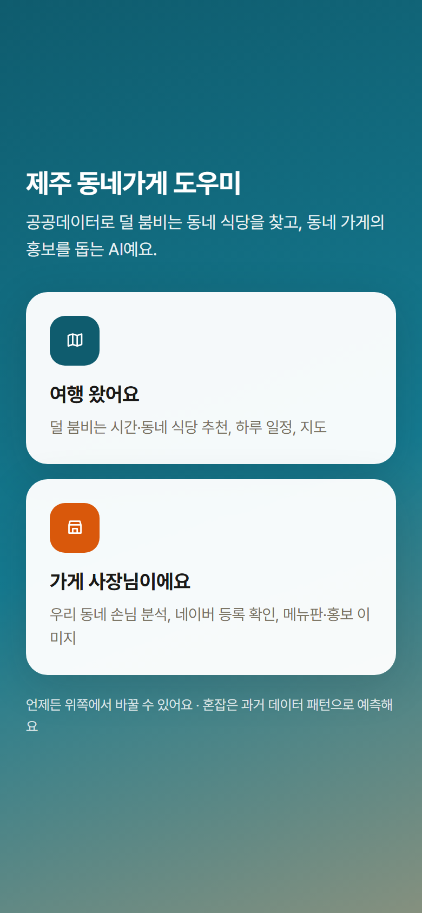
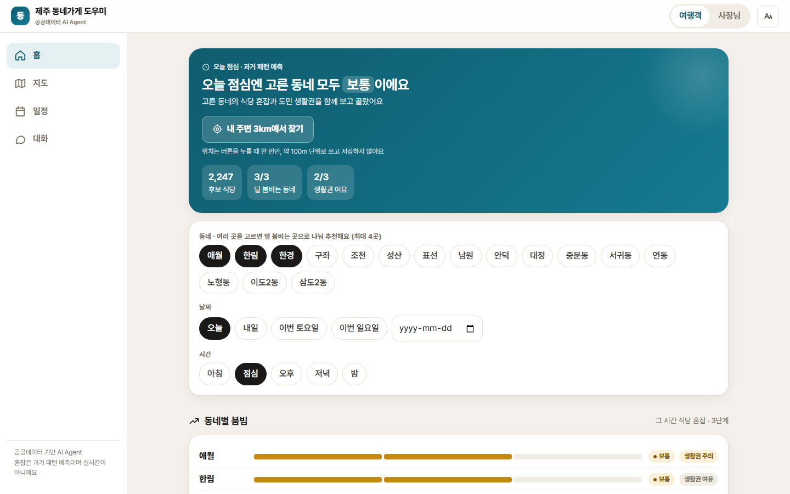
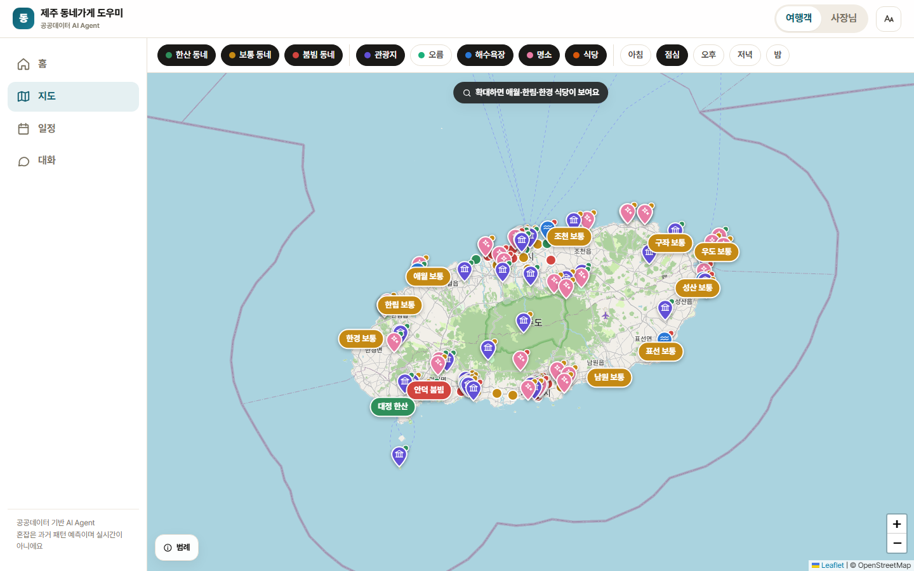
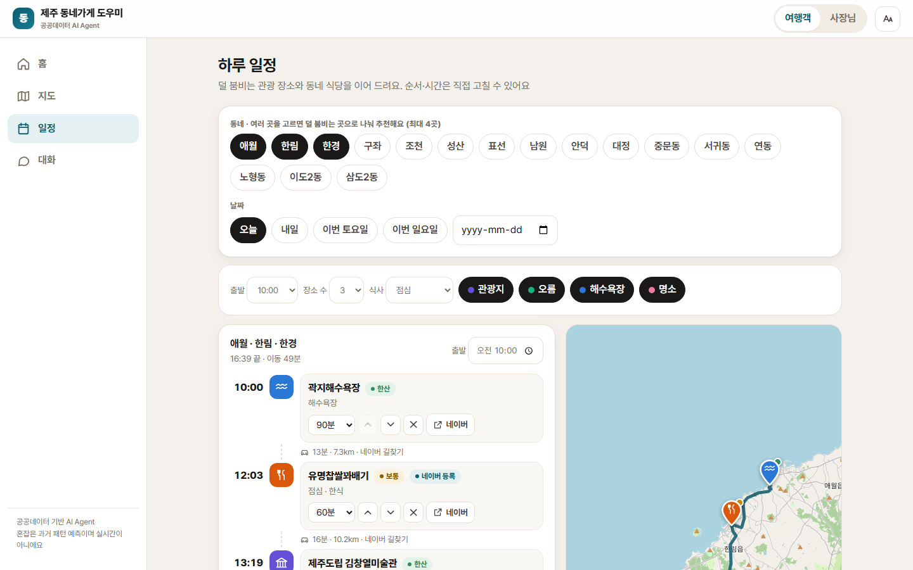
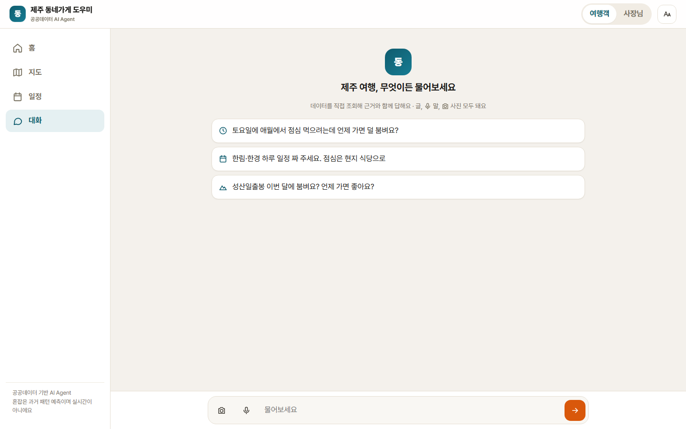
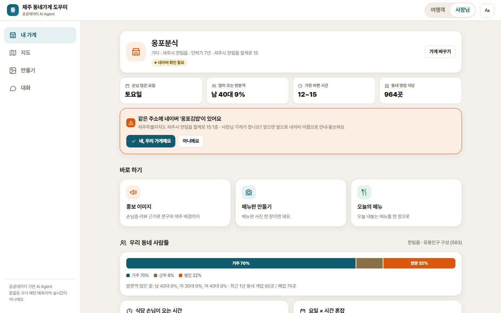
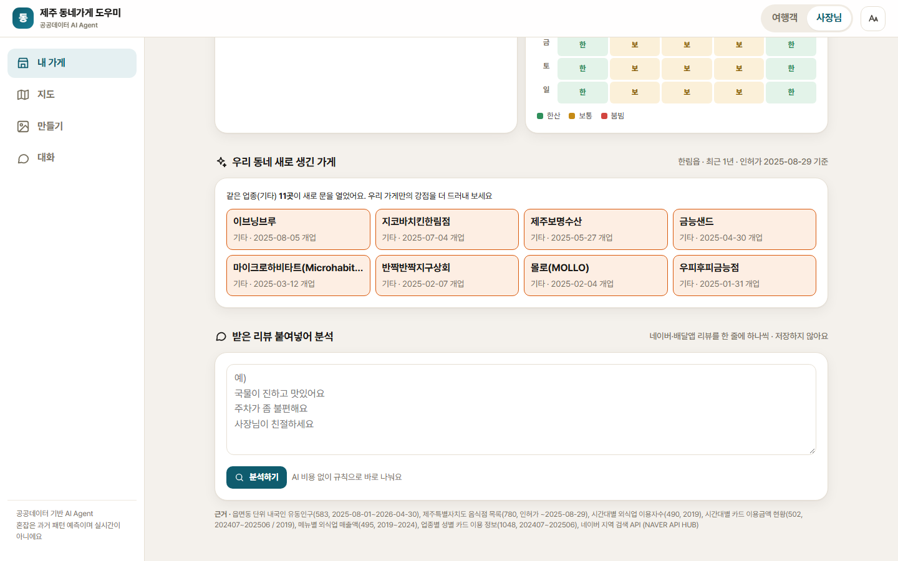
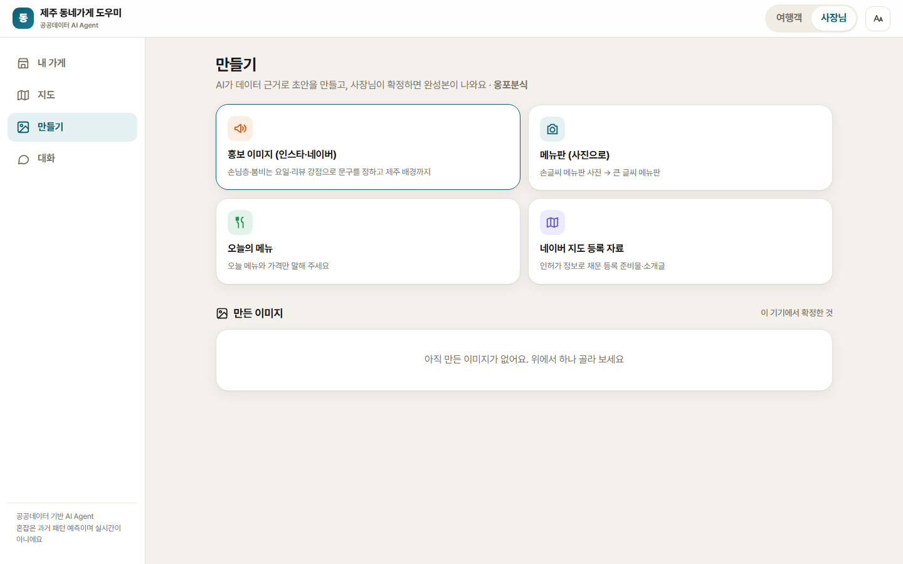

# 사용자 매뉴얼

제주 동네가게 도우미는 휴대폰과 PC 브라우저에서 씁니다. 설치 없이 주소로 들어가면 되고, 휴대폰에서는 '홈 화면에 추가'로 앱처럼 쓸 수 있습니다.

- 데모 주소: https://jeju-local-agent.web.app
- 센터 PC에서 직접 켜는 방법은 [README](../README.md) 2절을 보세요.

## 처음 들어가면

"여행 왔어요"와 "가게 사장님이에요" 중 하나를 고릅니다. 나중에 위쪽의 **여행객 / 사장님** 버튼으로 언제든 바꿀 수 있습니다.

- 글자가 작으면 오른쪽 위 **글자 크게(Aa)** 버튼으로 크게 볼 수 있습니다.
- 혼잡은 과거 데이터로 예측한 값입니다. 실시간이 아닙니다.

---

## 여행객

### 홈: 덜 붐비는 동네 식당

1. **바꾸기**를 눌러 동네(최대 4곳), 날짜, 시간(아침·점심·오후·저녁·밤)을 고릅니다.
2. **동네별 붐빔**에서 고른 시간에 어느 동네가 한산한지 봅니다. '생활권'은 도민이 사는 곳에 방문객이 얼마나 몰리는지입니다. 과밀한 동네는 도민 생활을 위해 덜 추천합니다.
3. **추천 동네 식당**은 점수 순입니다. 점수 아래 막대는 네 가지 기준(덜 붐빔, 생활권 여유, 숨은 가게, 오래된 가게)이 각각 얼마나 기여했는지 보여 줍니다.

식당 카드의 표시:

| 표시 | 뜻 |
|---|---|
| 네이버 등록 | 네이버 지도에서 찾을 수 있음 |
| 네이버엔 다른 상호 | 같은 자리에 다른 이름으로 등록됨 (간판이 바뀌었을 수 있음) |
| 숨은 가게 | 네이버 지도에 없음. 리뷰·영업시간 정보가 적음 |
| 영업 확인 / 방문 전 영업 확인 | 인허가는 폐업 신고를 안 하면 영업으로 남기 때문에 확인 정도를 표시 |
| 인허가 N년 | 인허가일부터 지난 햇수 (주인이 바뀌어도 이어질 수 있음) |

카드 버튼:

- **네이버 지도 / 위치 / 길찾기**: 네이버 지도에서 보기, 앱 안 지도에서 위치 보기, 카카오맵 길찾기
- **AI에게**: 이 가게에 대해 AI에게 묻기
- **찜**: 하트를 누르면 홈 아래 '찜한 가게'에 모입니다. 찜 목록은 이 기기에만 저장됩니다.
- **문 닫았어요**: 가 보니 문을 닫았으면 알려 주세요. 확인 전까지 추천에서 뺍니다.

### 내 주변 찾기

홈 위쪽의 **내 주변 3km에서 찾기**를 누르면 브라우저가 위치 사용을 묻습니다. 허용하면 지금 있는 곳에서 3km 안의 동네 식당을 거리·걷는 시간과 함께 보여 줍니다.

- 위치는 누를 때 한 번만, 약 100m 단위로 줄여서 쓰고 저장하지 않습니다.
- 휴대폰은 GPS로 정확하고, PC는 인터넷 주소로 추정해 틀릴 수 있습니다.

### 지도

- 동네 이름표 색이 혼잡입니다: 초록 한산 · 노랑 보통 · 빨강 붐빔.
- 핀 색은 장소 종류입니다: 보라 관광지 · 초록 오름 · 파랑 해수욕장 · 분홍 명소. 핀 아래 작은 점은 그 장소의 이번 달 혼잡입니다.
- 위쪽 버튼으로 보고 싶은 것만 켜고 끕니다. 오름은 조금 확대하면, 식당은 더 확대하면 나타납니다.
- 핀이나 이름표를 누르면 아래에 정보 창이 열리고 길찾기·네이버 지도로 이어집니다.

### 하루 일정

1. 동네·날짜, 출발 시각, 장소 수, 식사(점심 / 점심+저녁), 장소 종류를 고르면 덜 붐비는 순서로 일정이 만들어집니다.
2. 이동 시간은 네이버 길찾기(자동차) 기준입니다. 길찾기를 못 쓰면 '직선 추정'으로 표시합니다.
3. 직접 고치기: ↑↓로 순서 바꾸기, ✕로 빼기, 머무는 시간 바꾸기, **장소·식당 추가**로 넣기. 고치면 도착 시간과 이동 시간을 다시 계산합니다.
4. 찜한 가게가 있으면 '장소·식당 추가'에 함께 나오고, 홈의 **찜한 가게로 일정 짜기**를 누르면 식사 자리에 바로 들어갑니다.
5. **공유**: 휴대폰은 카톡 같은 앱으로 보내고, PC는 일정 글을 복사합니다. 장소마다 길찾기 링크가 들어갑니다.
6. **AI에게 다듬기**: 이 일정을 AI에게 보여 주고 바꿀 점을 묻습니다.

### 대화

글로 묻거나 마이크 버튼으로 말해서 묻습니다. 예:

- "토요일에 애월에서 점심 먹으려는데 언제 가면 덜 붐벼요?"
- "구좌에서 사람 많지 않은 현지 한식당 3곳 추천해 줘"
- "한림이랑 한경 이번 토요일 하루 일정 짜 주세요"

AI가 어떤 데이터를 보고 있는지 위쪽 작은 표시로 보여 주고, 답 끝에 **근거**(쓴 데이터)를 적습니다. 결과는 카드·막대·일정표로도 나옵니다.

---

## 사장님

### 내 가게

처음 한 번 가게 이름(필요하면 동네)으로 찾아 고르면 됩니다. 그 뒤로는 바로 내 가게 화면이 열립니다.

| 칸 | 내용 |
|---|---|
| 네이버 등록 상태 | 네이버 지도에서 이 이름으로 찾을 수 있는지. 같은 주소에 다른 이름의 가게가 있으면 **"네, 우리 가게예요 / 아니에요"**로 확인하고, 간판·네이버 이름이 다르면 그 이름을 적어 연결합니다 (주소가 같을 때만). 없으면 **등록 자료 받기**로 등록에 필요한 내용을 정리해 줍니다 |
| 손님 많은 요일·방문객·바쁜 시간 | 우리 동네 데이터로 본 요약 |
| 우리 동네 사람들 | 동네에 머무는 사람 중 거주·근무·방문 비율 |
| 식당 손님이 오는 시간 | 시간대별 비율 (가장 많은 시간 강조) |
| 요일 × 시간 혼잡 | 언제 한산하고 언제 붐비는지 |
| 손님 리뷰 요약 | 구글 리뷰가 있는 가게만. 좋다는 점·아쉽다는 점과 실제 문장 |
| 우리 동네 새로 생긴 가게 | 최근 1년 안에 문을 연 가게. 같은 업종은 주황색으로 표시 |
| 받은 리뷰 붙여넣어 분석 | 네이버·배달앱 리뷰를 한 줄에 하나씩 붙여넣고 **분석하기**. 저장하지 않습니다. **이 강점으로 홍보 문구 만들기**를 누르면 AI가 이어서 만듭니다 |

### 만들기

| 만들 것 | 하는 법 |
|---|---|
| 홍보 이미지 (인스타 피드·스토리) | 버튼을 누르면 AI가 손님층·리뷰·동네 데이터로 문구를 쓰고 제주 배경을 그려 미리보기를 보여 줍니다 |
| 메뉴판 | 지금 메뉴판 사진을 한 장 올리면 메뉴와 가격을 읽어 새 메뉴판을 만듭니다 |
| 오늘의 메뉴 | 오늘 내놓는 메뉴와 가격을 적으면 한 장으로 만듭니다 |
| 네이버 등록 자료 | 인허가 정보로 미리 채운 스마트플레이스 등록 내용 |

**확정은 사장님이 합니다.** 미리보기 아래 **확정** 또는 **고쳐 주세요**를 누르세요. AI는 사장님 답을 받기 전에는 확정할 수 없게 되어 있습니다. 가격과 문구를 꼭 확인해 주세요.

홍보 문구는 문장마다 근거(데이터, 사장님 말씀, 사진)가 있어야 만들어집니다. '제주 최고' 같은 근거 없는 표현은 쓰지 않습니다.

---

## 자주 묻는 것

| 질문 | 답 |
|---|---|
| 혼잡이 실제와 달라요 | 과거 패턴으로 예측한 값이라 행사·날씨·공사는 반영되지 않습니다 |
| 추천 가게가 문을 닫았어요 | 카드의 **문 닫았어요**를 눌러 주세요. 추천에서 뺍니다 |
| 우리 가게가 검색에 안 나와요 | 인허가 이름으로 찾습니다. 간판 이름과 다르면 인허가 상호나 주소 일부로 찾아 보세요 |
| 접속 코드를 물어요 | 공개 데모는 비용 때문에 AI 대화에 접속 코드를 씁니다. 운영자에게 받으세요. 홈·지도·일정·내 가게는 코드 없이 됩니다 |
| AI 답이 이상해요 | 답 끝의 '근거'를 확인하고, 다시 물어보거나 "근거 보여 줘"라고 해 보세요 |
