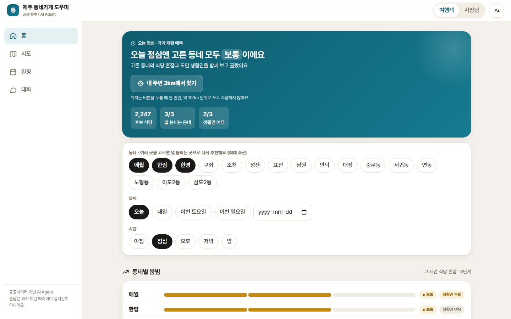
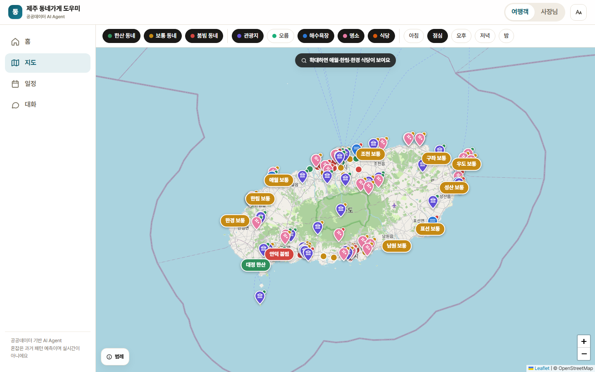
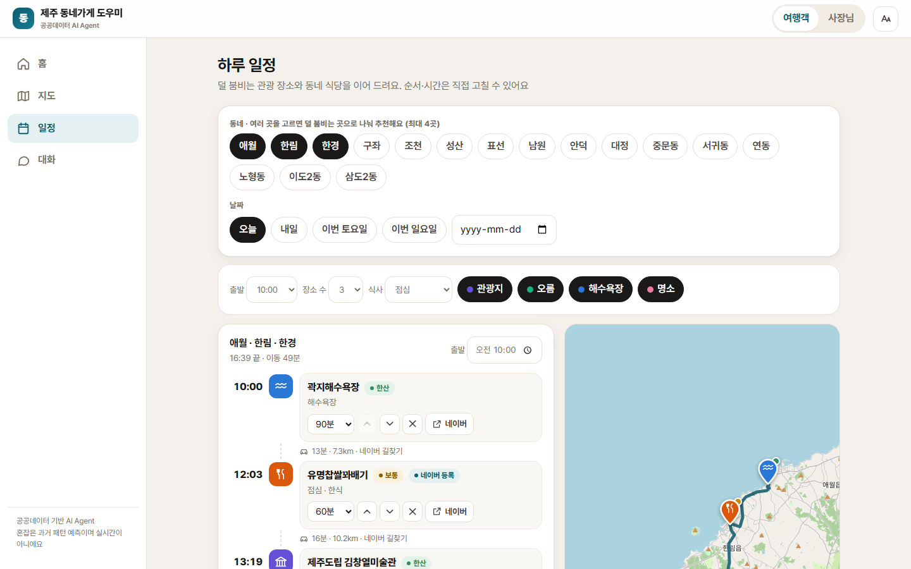
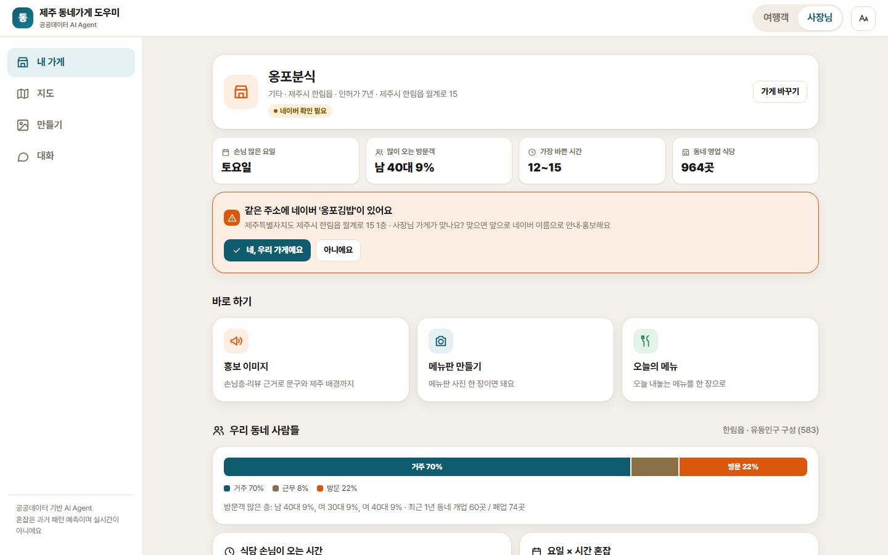
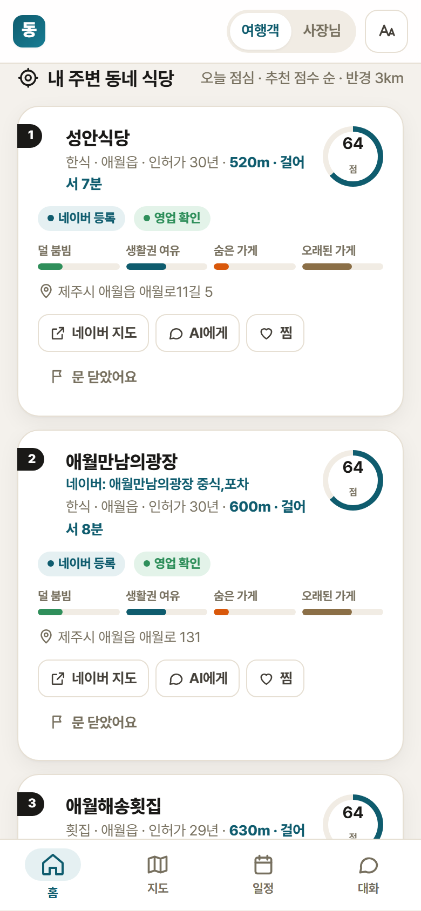
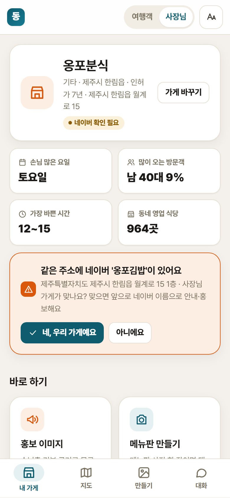
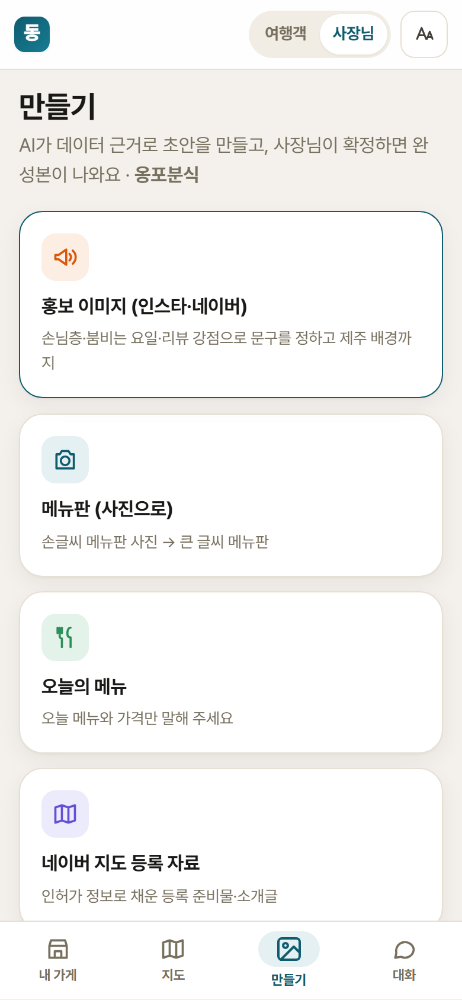

# 제주 동네가게 AI Agent — 시스템 종합 문서

> 기획, 데이터, Agent 설계, 사용 API·모델, 서버·화면, 배포, 검증, 개발 경과, 결정 사항, 제약을 한 문서에 모았습니다.
> 작성일: 2026-11-10, 갱신 2026-11-13 (코드 동결) · 세부 문서: [README](../README.md) · [결과 설명자료](결과설명자료.md) · [데이터 활용 명세](데이터활용명세.md) · [사용자 매뉴얼](사용자매뉴얼.md) · [개발 진행 기록](../개발진행.md) · [개발 계획](../개발계획.md)

---

## 목차

1. [한눈에 보기](#1-한눈에-보기)
2. [대회 정보와 일정](#2-대회-정보와-일정)
3. [기획](#3-기획)
4. [시스템 구조](#4-시스템-구조)
5. [AI Agent](#5-ai-agent)
6. [의사결정 모델](#6-의사결정-모델)
7. [데이터](#7-데이터)
8. [외부 API·서비스](#8-외부-api서비스)
9. [서버 API](#9-서버-api)
10. [웹 화면](#10-웹-화면)
11. [배포와 실행](#11-배포와-실행)
12. [검증과 평가](#12-검증과-평가)
13. [비용](#13-비용)
14. [개발 경과](#14-개발-경과)
15. [결정 사항](#15-결정-사항)
16. [오류·제약](#16-오류제약)
17. [개인정보·보안·AI 사용 공개](#17-개인정보보안ai-사용-공개)
18. [폴더 구조](#18-폴더-구조)
19. [남은 일](#19-남은-일)
20. [화면 캡처](#20-화면-캡처)

---

## 1. 한눈에 보기

| 항목 | 내용 |
|---|---|
| 이름 | 제주 동네가게 도우미 (제주 동네가게 AI Agent) |
| 한 줄 소개 | 공공 인허가 데이터로 네이버 지도에 잘 안 보이는 제주 동네 식당을 찾아, **사장님**에게는 손님 분석·네이버 등록·홍보물을, **관광객**에게는 덜 붐비는 현지 식당과 일정을 주는 단일 AI Agent |
| 데모 | https://jeju-local-agent.web.app (화면) · https://je-ju-426798142372.asia-northeast3.run.app (서버) |
| 소스 | https://github.com/sonnyd4y/je-ju (공개, 데이터 제외) |
| 핵심 기술 | Claude 도구 호출 Agent (도구 19개) + 직접 학습한 수요 예측 모델 + 다기준 추천 모델 + 공공데이터 15종 |
| 언어·프레임워크 | Python 3.11, FastAPI(SSE), SQLite, 바닐라 JS PWA, Leaflet |
| 검증 | Agent 시나리오 평가 16/16 통과, 단위 테스트 57개, 수요 예측 오차 18.9% |

---

## 2. 대회 정보와 일정

- 대회: 제주 AI·빅데이터 활용 AI Agent 개발 챌린지 (daker.ai)
- **최종 제출 마감: 2026-11-20(금) 10:00 KST**
- 제출물: ① AI Agent 기획서 1부(15쪽 이내) ② 최종 결과물 zip — 실행 소스 코드 / 실행환경·매뉴얼 / 데이터 활용 명세 / 결과 설명자료 (항목별 위치는 [00_먼저_읽어주세요.md](../00_먼저_읽어주세요.md), 만들기 `python scripts/make_submission.py`)
- 상호평가에는 기획서만 공개되고 최종 결과물 zip은 심사위원 평가에 쓰임. 평가용 외부 AI API 키는 사용 한도를 걸어 zip에 넣을 수 있고 평가 후 폐기 (대회 규칙 11/10 갱신)
- AI 사용 범위(개발에 쓴 Claude Code 포함) 공개 필수
- 11/23~27 상호 평가 투표에 참여하지 않으면 점수가 반영되지 않음

| 날짜 | 작업 | 상태 |
|---|---|---|
| 11/04 | 환경 세팅, 허브 데이터 확보, 가게 DB | 완료 |
| 11/09 | Agent·도구·카드 이미지·마케팅 절차·웹 화면·의사결정 모델·Cloud Run 배포 | 완료 |
| 11/10 | 기능 추가(내 주변·찜·공유·새 가게·리뷰 붙여넣기), Agent 평가 15/15, 제출 문서, Firebase 화면, 네이버 다른 상호 연결 | 완료 |
| 11/11 | 검증 표본 확인(사용자), 결과 설명자료 초안 | |
| 11/12 | 사용자가 직접 사용 → 수정 | |
| **11/13** | 최종 전체 평가 → **개발 마감 (코드 동결)** | |
| 11/14~16 | 기획서 PDF, 결과 설명자료 | |
| 11/17 | zip 리허설 (새 폴더에서 설치·실행) | |
| 11/18 | 시연 영상 촬영·업로드 | |
| **11/19** | 제출 | |
| 11/23~27 | 상호 평가 투표 | |

---

## 3. 기획

### 3-1. 문제

| 문제 | 설명 |
|---|---|
| 동네 식당이 플랫폼에 안 보임 | 어르신 사장님 비중이 높고 네이버 지도 등록 절차가 어렵다. 인허가(사업자) 상호와 간판 상호가 달라 검색에도 잘 안 걸린다 |
| 관광객이 유명한 곳에 몰림 | 특정 동네·시간에 쏠리고, 도민 생활권이 붐빈다 |
| 사장님에게 홍보 수단이 없음 | 메뉴판 디자인, 홍보 문구, 리뷰 대응을 직접 해야 한다 |
| 리뷰가 개선으로 이어지지 않음 | 리뷰를 실행할 수 있는 조치로 바꿔 주는 도구가 없다 |

### 3-2. 기존 서비스와 다른 점

| 기존 (네이버 지도, 여행 플래너) | 이 Agent |
|---|---|
| 가게가 직접 등록해야 노출 | **공공 인허가 데이터로 가게를 먼저 찾아냄** (영업 중 20,954곳) |
| 사용자가 메뉴·필터를 직접 조작 | 목표를 말하면 Agent가 조회·판단·생성을 이어서 수행 |
| 결과만 보여 줌 | **데이터 근거를 함께 제시**, 홍보 문장마다 근거 필수 |
| 리뷰는 쌓이기만 함 | 리뷰를 강점·불만으로 나눠 홍보 문구와 개선 제안으로 바꿈 |
| 관광객·사장님 앱이 따로 | **하나의 Agent**가 상대에 맞춰 역할 수행, 관광객 분산이 동네 가게 매출로 이어지는 구조 |

### 3-3. 사용자와 시나리오

**도민 사장님** (Claude Sonnet)

1. "우리 가게 좀 봐 줘" → 인허가 목록에서 가게 확인(`find_store`) → 네이버 등록 확인(`check_naver_listed`)
2. 미등록 후보면 **"네이버 지도에 다른 이름으로 이미 올라가 있나요?"를 먼저 물음** → 있으면 그 이름을 주소로 확인해 연결(`link_naver_name`), 없으면 등록 자료(`make_listing_kit`)
3. "언제 손님이 많아?" → 동네 상권·혼잡(`area_insight`, `predict_crowd`)
4. "손님들이 뭐래?" → 리뷰 강점·불만(`analyze_reviews`, 붙여넣은 리뷰는 `analyze_review_text`)
5. "홍보 이미지 만들어 줘" → 마케팅 브리프 → 문장마다 근거가 있는 초안 → 생성형 배경 → 카드 미리보기 → **사장님이 "네"라고 해야 확정**
6. 메뉴판 사진 한 장 → 메뉴·가격 읽기 → 확인 → 메뉴판 이미지

**관광객** (Claude Haiku)

1. "애월에서 점심, 너무 붐비지 않은 현지 식당" → 다기준 추천(`recommend_stores`)
2. 도민 생활권이 붐비는 동네는 점수를 낮춤(`resident_balance`)
3. "하루 일정 짜 줘" → 덜 붐비는 장소·식당을 실제 길찾기 시간으로 배치(`plan_itinerary`)

**서로 이득인 구조**: 관광객은 덜 붐비는 곳의 현지 식당을, 동네 가게는 플랫폼 밖에서도 노출을, 도민 생활권은 과밀 완화를 얻는다.

### 3-4. Agent가 스스로 하는 일과 사람 승인

| Agent가 스스로 함 | 사람 승인 필요 |
|---|---|
| 데이터 조회·분석, 혼잡 예측, 후보 추천, 리뷰 분류, 홍보 초안·이미지 미리보기, 네이버 상호 검색 | 메뉴 가격·홍보 문구·안내문 **확정**, 같은 주소 다른 상호를 **우리 가게로 연결** |

---

## 4. 시스템 구조

```
 [사용자 브라우저]  https://jeju-local-agent.web.app  (Firebase Hosting, 정적 파일)
   index.html · app.js · app.css · config.js(서버 주소) · sw.js(PWA)
        │  REST (데이터 화면, AI 비용 0)        │  POST /api/chat (SSE 스트리밍)
        ▼                                     ▼
 [서버]  Google Cloud Run `je-ju`  (FastAPI + uvicorn, Docker)
   ├─ app/api/main.py        엔드포인트, 접속 코드·하루 한도, 사진 업로드
   ├─ app/agent/loop.py      Claude 도구 호출 루프 (최대 12회 왕복)
   ├─ app/agent/tools.py     도구 19개 정의·입력 검증·승인 가드
   ├─ app/tools/*            실제 계산 (조회·예측·추천·네이버·리뷰·마케팅·초안·카드·이미지)
   └─ data/processed/jeju.db  SQLite (WAL) + demand_model.joblib
        │
        ├─ Claude API (Anthropic)            Agent 판단·답·메뉴판 사진 읽기
        ├─ 네이버 지역 검색 (API HUB)          네이버 지도 등록 여부·상호 확인
        ├─ NCP Maps Geocoding / Directions   주소→좌표, 자동차 길찾기
        └─ Gemini 이미지 (나노바나나)           홍보 카드 배경
```

- 홈·지도·일정·내 가게 화면은 **AI를 거치지 않고** 도구 함수를 REST로 바로 부른다. AI는 '대화'와 '만들기'에서만 쓴다.
- 같은 도구 함수를 Agent와 화면이 함께 쓰므로 답과 화면 숫자가 같다.

---

## 5. AI Agent

### 5-1. 루프 ([app/agent/loop.py](../app/agent/loop.py))

| 항목 | 값 |
|---|---|
| 방식 | Anthropic Python SDK로 직접 만든 도구 호출 루프 (판단 → 도구 선택 → 실행 → 결과 확인 → 다시 판단 → 답) |
| 모델 | 사장님 `claude-sonnet-5-5`, 관광객 `claude-haiku-5-5` (`.env`의 `CLAUDE_MODEL_OWNER/TOURIST`), 기본 `claude-opus-5-5` |
| 추론 강도 | `output_config.effort = medium` (`CLAUDE_EFFORT`) |
| 최대 왕복 | 한 질문에 도구 12회 (`MAX_TURNS`) |
| 출력 한도 | `max_tokens` 16,000 |
| 프롬프트 캐시 | 시스템 프롬프트에 `cache_control: ephemeral` (날짜 등 변하는 값은 넣지 않음) |
| 거절 시 대체 | 안전 분류기가 거절하면 서버 쪽 대체 모델로 재시도 (`server-side-fallback-2026-07-01`, Sonnet·Opus) |
| 입력 | 글, 사진(jpeg·png·webp·gif, 5MB 이하), 음성(브라우저 Web Speech로 글로 바꿈) |
| 출력 이벤트 | `text`, `tool_call`, `tool_result`, `usage`(토큰·달러), `error` → SSE로 화면에 실시간 전달 |
| 대화 상태 | 서버 메모리의 세션. 같은 세션에 답이 끝나기 전 새 질문은 막음 |

### 5-2. 도구 19개 ([app/agent/tools.py](../app/agent/tools.py))

| 분류 | 도구 | 하는 일 | 구현 |
|---|---|---|---|
| 조회 | `find_store` | 상호(오타 허용)·주소로 인허가 목록에서 가게 하나 찾기 | stores.py |
| 조회 | `search_stores` | 동네·업종·개업일·네이버 미등록 여부로 가게 목록 | stores.py |
| 분석 | `area_insight` | 동네 상권 요약: 방문객 성별·연령, 요일 패턴, 식당 시간대, 개업·폐업, 인기 메뉴 | insight.py |
| 예측 | `predict_crowd` | 요일·시간대별 식당 혼잡(한산/보통/붐빔), 날짜를 주면 수요 예측 모델 사용 | insight.py, forecast.py |
| 분석 | `resident_balance` | 거주 대비 방문 비율 → 도민 생활권 과밀/주의/여유 | insight.py |
| 추천 | `recommend_stores` | 여러 동네를 비교하는 다기준 식당 추천, 기준별 점수 공개 | recommend.py |
| 일정 | `plan_itinerary` | 덜 붐비는 관광 장소 + 추천 식당을 가까운 순서·실제 이동 시간으로 | places.py, route.py |
| 장소 | `place_crowd` | 오름·해수욕장·관광지의 그 달 혼잡과 가장 한산한 달 | places.py |
| 네이버 | `check_naver_listed` | 네이버 지도 등록 여부 (등록 / 다른 상호로 등록 / 확인 필요 / 미등록 후보) | naver.py |
| 네이버 | `link_naver_name` | 사장님이 알려 준 네이버 상호로 검색해 **주소가 같을 때만** 연결, 아니라고 하면 미등록으로 기록 | naver.py |
| 네이버 | `make_listing_kit` | 스마트플레이스 등록 자료 묶음 (인허가로 채운 기본 정보, 준비물, 순서) | listing.py |
| 리뷰 | `analyze_reviews` | 구글 리뷰(903)를 맛·양·가격·친절·위생·주차·대기·분위기별 긍정/부정으로 | reviews.py |
| 리뷰 | `analyze_review_text` | 사장님이 붙여넣은 리뷰 글을 강점·불만으로 (저장 안 함) | reviews.py |
| 마케팅 | `marketing_brief` | 진단·리뷰 강점/불만·손님층·타깃 후보·게시 시점·메시지·채널, 사실마다 근거 번호(E1…) | marketing.py |
| 초안 | `save_draft` | 홍보(promo)·메뉴판(menu)·안내문(notice)·오늘의 메뉴(today)·소개글(intro) 초안 저장. 문장마다 근거 필수, 최상급 표현 차단 | drafts.py |
| 승인 | `decide_draft` | 사장님 답을 받은 **다음 차례에서만** 확정/반려 (코드로 강제) | drafts.py |
| 이력 | `list_drafts` | 초안·확정본·이전 버전 | drafts.py |
| 이미지 | `render_card` | 메뉴판 1080×1350, 피드 1080×1080, 스토리 1080×1920 PNG (HTML 템플릿 + Playwright) | cards.py |
| 이미지 | `generate_background` | 생성형 배경 (글자·음식·사람 없음), 하루 30장 한도 | imagegen.py |

### 5-3. 시스템 프롬프트 규칙 ([app/agent/prompts.py](../app/agent/prompts.py))

- **답 형식**: 결론 한 문장 → 짧은 목록 → 질문 하나 → "근거:" 한 줄. 전문 용어는 그대로 쓰고 처음 나올 때 괄호로 풀이. 근거 번호(E1)는 사장님께 보이지 않음.
- **사장님**: 가게 이야기가 나오면 먼저 `find_store`. 네이버는 '미등록 후보·확인 필요'라도 **다른 이름으로 이미 올라가 있는지 먼저 묻고**, 없다고 할 때만 등록 자료. 가게 햇수는 '인허가 기준 N년'.
- **마케팅 절차**: ① 진단(`marketing_brief`) → ② 타깃·시점·메시지를 Agent가 데이터로 결정 → ③ 초안·배경·미리보기 → ④ 한 번만 확인 → ⑤ "네"면 확정·최종본.
- **관광객**: 혼잡은 과거 패턴 예측이며 실시간이 아님을 밝힘. 생활권이 붐비는 동네는 덜 추천.
- **범위 밖**: 제주 밖·식당과 무관한 질문은 도구 없이 범위를 안내. "제주 최고·1위" 같은 근거 없는 표현은 거절.

### 5-4. 안전장치

| 장치 | 방법 |
|---|---|
| 승인 없이 확정 금지 | 초안을 만든 같은 차례에서 `decide_draft`를 코드가 막음 |
| 근거 없는 문장 금지 | `save_draft`가 문장마다 근거(E번호·'사장님 말씀'·'사진')를 요구, 최고·1위·유일·원조 차단 |
| 숫자 지어내기 감시 | 평가에서 답의 숫자가 도구 결과에 있는지 자동 검사 |
| 남의 가게에 잘못 연결 금지 | 네이버 상호 연결은 주소가 같을 때만, 같은 주소 후보는 사장님 확인 후 |
| 메뉴 가격 정확도 | 메뉴판·가격 글자는 AI 이미지가 아니라 템플릿으로 그림 |
| 생성 이미지 표시 | 카드에 'AI 생성 배경' 표시, 음식은 사장님 실제 사진만 |
| 과다 사용 방지 | 공개 데모의 접속 코드(`DEMO_ACCESS_CODE`), 하루 대화 한도(`DEMO_DAILY_LIMIT`, 기본 300), 이미지 하루 30장 |

---

## 6. 의사결정 모델

LLM은 대화·도구 선택·문구를 맡고, 계산·판단은 재현 가능한 모델이 맡는다 (결정 D-09).

### 6-1. 방문 수요 예측 ([app/tools/forecast.py](../app/tools/forecast.py), [scripts/train_demand.py](../scripts/train_demand.py))

| 항목 | 내용 |
|---|---|
| 모델 | scikit-learn HistGradientBoosting |
| 입력 | 동네, 요일, 공휴일, 연휴 길이, 연휴 전후, 계절 (583 유동인구) |
| 출력 | 그 날 방문 / 평소 비율 |
| 학습·검증 | 2025-08~2026-02 학습, 2026-03~04 검증 |
| 성능 | 오차(MAPE) **18.9%** (요일 평균 방식 22.8%), 혼잡 등급 일치 **59.4%** (36.9%) |
| 한계 | 공휴일 표본이 2일뿐이라 공휴일은 일요일 패턴으로 대체 |
| 속도 | 날짜별로 42개 동네를 한 번에 예측하고 캐시(`_day_preds`), 서버 시작 때 모델을 미리 불러옴 → 지도 첫 표시 약 0.4초 |

### 6-2. 혼잡 등급 (결정 D-06)

```
혼잡 지수 = 요일 계수 (583: 이 동네 해당 요일 방문 / 평균, 날짜가 있으면 예측 모델)
          × 시간대 계수 (490 2019년 비율 × 502 최근 카드 보정, 동네 관광객 비중으로 가중)
          × 관광 밀도 (583: 방문/거주, 제주 중앙값 대비)
등급: 제주 전체 (행정동 × 요일 7 × 시간대 5) 분포의 하위 40% 한산 / 상위 20% 붐빔
```

관광 장소는 월별 혼잡(와이파이·관광지 유입)에 607 관광지 시간대 패턴(오후 붐빔·오전 한산)을 더해 한 단계 조정한다.

### 6-3. 관광객 추천 ([app/tools/recommend.py](../app/tools/recommend.py))

| 기준 | 가중치 | 데이터 |
|---|---|---|
| 덜 붐빔 | 0.35 | 혼잡 등급 |
| 생활권 여유 | 0.25 | 거주 대비 방문 (583) |
| 숨은 가게 | 0.20 | 네이버 미등록 (네이버 판별) |
| 오래된 가게 | 0.20 | 인허가 햇수 (780) |

- `priority`로 한 기준을 강조할 수 있고, 같은 입력이면 같은 순위. 결과마다 기준별 점수를 보여 준다.
- '영업 확인'은 네이버에 **같은 이름으로** 등록된 경우만. 해수욕장 계절음식점·청년회·부녀회 인허가는 제외.

### 6-4. 리뷰 감성

- 오픈소스 KoELECTRA 감성 모델(Apache-2.0)로 리뷰 5,309개 절을 미리 판단해 DB에 저장 (CPU 9분, 규칙과 일치율 90%). 서버에는 PyTorch가 필요 없다.
- 붙여넣은 리뷰는 규칙 기반으로 줄마다 요인을 나눈다 (최대 300줄, 저장 안 함).

### 6-5. 네이버 등록 판별 ([app/tools/naver.py](../app/tools/naver.py))

1. 인허가 상호 + 동네로 검색 → 이름 비슷한 정도(rapidfuzz)와 주소(도로명·지번) 비교
2. 못 찾으면 상호 앞 4글자 + 동네, **도로명 주소 그대로**(`제주 ○○로 15`), 동네 + 업종, 도로 + 업종으로 다시 검색
3. 결과: `등록`(이름·주소 일치) / `다른 상호로 등록`(같은 주소에 다른 이름 → 사장님 확인 필요) / `확인 필요` / `미등록 후보`
4. 사장님이 확인한 결과(`사장님 확인: …`, `사장님: '…'은 우리 가게 아님`)는 일괄 재확인에서 덮어쓰지 않음

현재 판별 2,779곳: 같은 이름으로 등록·연결 1,812 · 확인 필요 352 · 미등록 후보 615.

---

## 7. 데이터

### 7-1. 제주데이터허브 데이터 15종

| ID | 데이터 | 기간 | 쓰는 곳 |
|---|---|---|---|
| 780 | 음식점 목록(통합) | 인허가 ~2025-08-29 | 가게 찾기, 추천 후보, 개업·폐업, 네이버 확인 대상 |
| 583 | 읍면동 내국인 유동인구 | 2025-08-01~2026-04-30 | 수요 예측 학습, 거주·근무·방문 구성, 생활권 과밀 |
| 490 | 시간대별 외식업 이용자수 | 2019 | 식당 시간대 비율 (코로나 이전) |
| 502 | 시간대별 카드 이용금액 | 2019, 2024-07~2025-06 | 시간대 비율 최근 보정 |
| 504 | 요일별 카드 이용 건수 | 2024-07~2025-06 | 요일 계수 |
| 495 | 메뉴별 외식업 매출액 | 2019~2024 | 동네 인기 메뉴 |
| 1048 | 업종별 성별 카드 이용 | 2024-07~2025-06 | 식당 손님 구성 (도민·관광객, 성별) |
| 568 | 와이파이 장소별 사용자 | 2018-01~2025-09 | 관광 장소 월 혼잡 |
| 591 | 관광지별 내국인 유입자 | 2018-01~2024-12 | 관광지 월 혼잡 |
| 592 | 관광지별 외국인 유입자 | 2018-01~2024-12 | 관광지 월 혼잡 |
| 607 | 관광지·상업지구 시간대별 카드 | 2016-09~2017-11 | 관광지 시간대 보정 (비율만) |
| 811 | 오름 위치 | - | 일정·지도 |
| 784 | 해수욕장 정보 | - | 일정·지도 |
| 903 | 구글 음식점 리뷰 원천 | 2021 | 리뷰 요인 분석, 홍보 근거 |
| 906 | 구글 음식점 리뷰 분석 | 2011-10~2021-10 | 가게 평점 |

받았지만 쓰지 않음: 781·782(780에 포함), 569(와이파이 사용량), 837(숙박업).
허브 API 규격: `https://open.jejudatahub.net/api/proxy/{dataKey}/{projectKey}`, `number`·`limit`(최대 100), 데이터별 하루 1,000회.

### 7-2. DB 테이블 (`data/processed/jeju.db`, 2026-11-10 기준 행 수)

| 테이블 | 행 | 내용 |
|---|---|---|
| `stores` | 51,111 (영업 20,954) | 음식점 인허가, 좌표 20,941곳 |
| `naver_check` | 2,779 | 네이버 판별 결과 |
| `pop_daily` / `pop_profile` | 11,739 / 688 | 유동인구 일별·구성 |
| `meal_time_pattern` / `card_time` / `time_recent_factor` | 60 / 30 / 15 | 시간대 패턴·보정 |
| `dow_factor` | 7 | 요일 계수 |
| `menu_sales` | 156 | 메뉴별 매출 |
| `card_food_customer` | 56 | 식당 손님 구성 |
| `wifi_monthly` / `sight_monthly` / `district_time` | 109,833 / 2,846 / 25 | 관광 혼잡 원자료 |
| `pois` / `poi_month` | 429 / 1,178 | 관광 장소(오름 344·해수욕장 11·관광지 34·명소 40)와 월 혼잡 |
| `region_centroids` | 42 | 동네 중심 좌표 |
| `reviews` / `review_aspects` / `place_ratings` | 5,134 / 6,503 / 19,155 | 리뷰, 요인별 감성, 평점 |
| `geocode_cache` / `route_cache` | 15,307 / 30 | 좌표·길찾기 캐시 |
| `drafts` / `store_reports` | 0 / 0 | 초안·승인 이력, "문 닫았어요" 신고 (사용하면 쌓임) |
| `image_log` / `license_changes` | - | 이미지 생성 기록, 인허가 갱신 기록 (처음 쓸 때 만들어짐) |
| `data_sources` | 13 | 데이터 출처·기간 (Agent의 "근거:" 줄) |

### 7-3. 전처리 순서

```
data/raw/<ID>/*.csv
  build_store_db.py        780 → stores (가게 키 = 상호+주소+인허가일, 업태 통일, 영업/폐업)
  fetch_hub_api.py         API형 (583, 591, 592, 811)
  build_insight_db.py      583·490·502·504·495·1048·568·607·903·906 → 분석 테이블
  build_pois.py            관광 장소 429곳 + 월별 혼잡
  geocode_regions.py       동네 중심 좌표 (NCP)
  geocode_stores.py        가게 좌표 (NCP)
  check_naver.py           네이버 등록 판별
  train_demand.py          수요 예측 모델
  build_review_sentiment.py  KoELECTRA 감성
  sync_licenses.py         새 인허가 파일과 비교해 변경분만 반영
```

주요 처리: 법정동(가게 주소) ↔ 행정동(유동인구) 대응표(`regions.py`), 리(里) 이름은 지번 주소로 읍·면 연결, 583은 누적 집계라 비율로만 사용, 리뷰 작성자 정보 삭제, 와이파이 AP 번호 제거 후 장소 단위 합산. 자세한 내용은 [데이터 활용 명세](데이터활용명세.md).

---

## 8. 외부 API·서비스

| 서비스 | 제공처 | 쓰는 곳 | 키 (`.env`) | 한도·단가 | 없으면 |
|---|---|---|---|---|---|
| Claude API | Anthropic | Agent 판단·답·메뉴판 사진 읽기 | `ANTHROPIC_API_KEY` | Sonnet 5.5 입력 $2/출력 $10, Haiku 5.5 $0.10/$0.50 (100만 토큰) | 대화·만들기만 안 됨 |
| 네이버 지역 검색 (API HUB) | 네이버 클라우드 | 네이버 지도 등록·상호 확인 | `NAVER_SEARCH_CLIENT_ID/SECRET` | 하루 25,000회, 요청당 결과 5개 | 새 가게 확인 불가 (이미 확인한 2,779곳은 DB 사용) |
| Maps Geocoding | 네이버 클라우드 | 주소 → 좌표 | `NCP_CLIENT_ID/SECRET` | 월 300만 무료 | 좌표 캐시 사용 |
| Maps Directions 5 | 네이버 클라우드 | 일정 자동차 이동 시간·경로 | `NCP_CLIENT_ID/SECRET` | 월 6만 무료 | 직선거리×1.3, 시속 35km 추정 |
| Gemini `gemini-nano-banana-2.1` | Google | 홍보 카드 배경 | `GEMINI_API_KEY` | 1K 한 장 약 $0.034, 하루 30장 | 기본 배경 |
| 제주데이터허브 API | 제주특별자치도 | 데이터 수집 (준비 단계) | `JEJUDATAHUB_PROJECT_KEY` | 데이터별 하루 1,000회 | 실행에는 불필요 |
| OpenStreetMap 타일 | OSM 기여자 | 지도 배경 | 없음 | ODbL, 출처 표시 | - |
| 카카오맵·네이버 지도 링크 | 카카오·네이버 | "길찾기", "네이버 지도" 버튼 (링크만) | 없음 | - | - |
| Google Cloud Run | Google | 서버 | gcloud 로그인 | 요청 기반 과금 | 로컬 실행 |
| Firebase Hosting | Google | 화면 | gcloud 토큰 | 무료 등급 | 서버가 `/`에서 화면도 제공 |

### API 출처 (실제 호출 주소)

코드에서 실제로 부르는 주소입니다. 키는 요청 헤더로만 보내고 주소에는 넣지 않습니다.

| 서비스 | 호출 주소 | 코드 | 공식 안내 |
|---|---|---|---|
| Claude Messages API | `https://api.anthropic.com/v1/messages` (Anthropic Python SDK `anthropic`) | [loop.py](../app/agent/loop.py) | https://docs.anthropic.com |
| 네이버 지역 검색 (API HUB) | `https://naverapihub.apigw.ntruss.com/search/v1/local` | [naver.py](../app/tools/naver.py) | https://www.ncloud.com (API HUB) |
| NCP Maps Geocoding | `https://maps.apigw.ntruss.com/map-geocode/v2/geocode` (예비 `naveropenapi.apigw.ntruss.com`) | [route.py](../app/tools/route.py) | https://www.ncloud.com/product/applicationService/maps |
| NCP Maps Directions 5 | `https://maps.apigw.ntruss.com/map-direction/v1/driving` (예비 `naveropenapi.apigw.ntruss.com`) | [route.py](../app/tools/route.py) | 〃 |
| Gemini 이미지 생성 | `https://generativelanguage.googleapis.com` (Google Gen AI SDK `google-genai`) | [imagegen.py](../app/tools/imagegen.py) | https://ai.google.dev |
| 제주데이터허브 API | `https://open.jejudatahub.net/api/proxy/{dataKey}/{projectKey}` | [fetch_hub_api.py](../scripts/fetch_hub_api.py) | https://www.jejudatahub.net |
| Firebase Hosting REST | `https://firebasehosting.googleapis.com/v1beta1` | [deploy_firebase.py](../scripts/deploy_firebase.py) | https://firebase.google.com/docs/hosting |
| OpenStreetMap 타일 | `https://{s}.tile.openstreetmap.org/{z}/{x}/{y}.png` | [app.js](../app/static/app.js) | https://www.openstreetmap.org/copyright |
| 네이버 지도 링크 | `https://map.naver.com/p/search/{가게 이름}` | app.js, cards.py | 링크만 연결 |
| 카카오맵 길찾기 링크 | `https://map.kakao.com/link/to/{이름},{위도},{경도}` | app.js | 링크만 연결 |
| 화면 라이브러리 CDN | `unpkg.com/leaflet`, `cdn.jsdelivr.net/npm/marked`, `cdn.jsdelivr.net/npm/dompurify`, `cdn.jsdelivr.net/gh/orioncactus/pretendard` | [index.html](../app/static/index.html) | 각 저장소 |

**오픈소스**: scikit-learn·joblib(수요 예측), KoELECTRA·PyTorch·transformers(감성, 준비 단계만), pandas·openpyxl, FastAPI·uvicorn·python-multipart, anthropic·google-genai, requests·python-dotenv, rapidfuzz(상호 비교), holidays(공휴일), Jinja2·Playwright 1.64.1·qrcode(카드 이미지), pytest, Leaflet 1.9.4, marked 12.0.2·DOMPurify 3.1.6, Pretendard·Noto Sans CJK 글꼴. 라이선스는 [데이터 활용 명세](데이터활용명세.md) 4절.

---

## 9. 서버 API ([app/api/main.py](../app/api/main.py))

| 메서드·경로 | 하는 일 |
|---|---|
| `GET /api/health` | 상태, 키 설정 여부(값은 안 보냄) |
| `POST /api/chat` | Agent 대화 (SSE). 글·사진·모드·세션, 접속 코드·하루 한도 검사 |
| `GET /api/stores` | 가게 목록 (동네·업종·개업일·미등록·키워드) |
| `GET /api/stores/find` | 가게 하나 찾기 |
| `GET /api/insight` | 동네 상권 요약 |
| `GET /api/crowd` | 혼잡 예측 |
| `GET /api/balance` | 생활권 과밀 |
| `GET /api/recommend` | 다기준 추천 |
| `GET /api/nearby` | 내 주변 3km 추천 (제주 범위 검사, 좌표 소수 셋째 자리로 줄임) |
| `GET /api/map` | 지도 데이터 (동네 혼잡, 관광 장소, 식당) |
| `GET /api/itinerary` | 자동 일정 |
| `GET /api/itinerary/candidates` · `POST /api/itinerary/schedule` | 직접 고친 일정 다시 계산 |
| `GET /api/naver` | 네이버 등록 판별 |
| `POST /api/naver/link` | 네이버 상호로 연결 `{store_id, naver_name, confirm}` |
| `POST /api/reviews/analyze` | 붙여넣은 리뷰 분석 (저장 안 함) |
| `GET /api/store/{id}` | 내 가게 대시보드 (KPI, 유동인구 구성, 시간대, 요일×시간 혼잡, 리뷰, 동네 새 가게) |
| `GET /api/cards/{name}` | 만든 카드 이미지 |
| `POST /api/report` | "문 닫았어요" 신고 |
| `GET /api/regions` | 동네 목록 |

---

## 10. 웹 화면

바닐라 JS 한 페이지 앱([app/static/](../app/static/)), 휴대폰 홈 화면 설치(PWA), PC는 왼쪽 메뉴·휴대폰은 하단 탭, 글자 크게 버튼.

| 여행객 | 사장님 |
|---|---|
| **홈**: 동네별 혼잡, 추천 식당 카드(점수 구성), 내 주변 3km 추천, 찜한 가게 | **내 가게**: 네이버 상태(다른 상호 확인 카드), 손님 많은 요일·시간, 유동인구 구성, 요일×시간 혼잡, 리뷰 요약, 동네 새로 생긴 가게, 리뷰 붙여넣기 |
| **지도**: 동네 혼잡, 관광지·오름·해수욕장·명소, 식당 (확대 단계별), 시간대 바꾸기 | **만들기**: 홍보 이미지, 메뉴판(사진), 오늘의 메뉴, 네이버 등록 자료 |
| **일정**: 덜 붐비는 순서, 실제 길찾기 시간, 순서·빼기·추가·머무는 시간 고치기, 찜한 가게 넣기, 공유 | **지도** |
| **대화**: AI Agent, 결과를 카드·막대·일정표로, 음성 입력 | **대화**: 미리보기에 "확정 / 고쳐 주세요" 버튼 |

색: 바다 청록 `#0f5c6e`, 귤색 `#d9580b`, 모래색 배경 `#f5f1ea`. 혼잡은 한산(초록)·보통(노랑)·붐빔(빨강) + 글자로 함께 표시.

---

## 11. 배포와 실행

### 11-1. 데모 배포

| 대상 | 위치 | 방법 |
|---|---|---|
| 서버 | Cloud Run `je-ju` (GCP 프로젝트 `jeju-local-agent`, 서울 `asia-northeast3`) | `gcloud run deploy je-ju --source . --region asia-northeast3` |
| 화면 | Firebase Hosting `jeju-local-agent.web.app` (Firebase 프로젝트 `jeju-36607`) | `python scripts/deploy_firebase.py` (REST 배포, `config.js`에 서버 주소) |

- Docker: `python:3.11-slim` + `fonts-noto-cjk` + `libatomic1` + Playwright Chromium. DB와 모델 파일은 이미지에 함께 들어감 → **배포하면 데모 DB가 초기화됨** (배포 전 WAL 체크포인트 필요).
- 키는 Cloud Run 환경 변수로만 넣는다. 화면 캐시 갱신용 버전: `app.js?v=9`, `app.css?v=5`.

### 11-2. 로컬 실행

```bash
pip install -r requirements.txt
python -m playwright install chromium
copy .env.example .env          # 키 입력
uvicorn app.api.main:app --port 8000      # http://localhost:8000
python scripts/chat.py --mode owner       # 터미널 대화
```

- Windows 10/11 또는 Linux, Python 3.11, 인터넷 필요. **GPU 불필요** (빅데이터센터 PC i7-8700 / GTX 1060 / 32GB에서 실행 가능).

### 11-3. 환경 변수

`ANTHROPIC_API_KEY`, `CLAUDE_MODEL`, `CLAUDE_EFFORT`, `CLAUDE_MODEL_OWNER`, `CLAUDE_MODEL_TOURIST`, `GEMINI_API_KEY`, `NCP_CLIENT_ID`, `NCP_CLIENT_SECRET`, `NAVER_SEARCH_CLIENT_ID`, `NAVER_SEARCH_CLIENT_SECRET`, `JEJUDATAHUB_PROJECT_KEY`, `DEMO_ACCESS_CODE`, `DEMO_DAILY_LIMIT`, `DATA_MODE` (hub/center). 값은 `.env`에만 두고 저장소에 넣지 않는다. 제출 zip에는 평가용 AI API 키(Claude·Gemini)만 넣는다.

---

## 12. 검증과 평가

### 12-1. Agent 시나리오 평가 ([scripts/eval_agent.py](../scripts/eval_agent.py))

- 검사 항목: 필요한 도구 호출(같은 일을 하는 도구는 `a|b`로 허용), 부르면 안 되는 도구, 승인 전 확정 금지, 근거 표기, **답의 숫자가 도구 결과에 있는지**, 메뉴 가격 정확도, 여러 차례 대화
- `--model auto`(기본) = 실제 서비스처럼 사장님 Sonnet, 관광객 Haiku
- 결과: **16/16 통과** (2026-11-13 코드 동결, 사장님 11·관광객 4·범위 밖 1, $0.581) → [eval_results.json](eval_results.json). 1차 15/16 중 실패 1건은 '먼저 묻기' 규칙과 맞지 않던 평가 기준을 두 차례 대화로 고쳐 재실행 (이전: 11/10 15/15)
- 상호가 완전히 바뀐 실제 가게 3곳 재현 (DB 복사본, $0.090): 연화반점→금짬뽕(먼저 묻고 연결), (주)앤드유→AND유CAFE(바로 연결), 시간낭비→우무(아니라고 하자 미등록 기록 후 등록 자료) 모두 정상

### 12-2. 모델별 비교 (같은 12개 시나리오, 11/09)

| 모델 | 통과 | 시나리오당 비용 | 비고 |
|---|---|---|---|
| Claude Opus 5.5 | 12/12 | $0.101 | |
| Claude Sonnet 5.5 | 11/12 | $0.048 | 실패 1건은 크레딧 소진 오류 |
| Claude Haiku 5.5 | 11/12 | $0.003 | 리뷰 도구를 따로 안 부름 (결과물은 정상) |

→ 사장님 Sonnet, 관광객 Haiku로 결정 (D-11).

### 12-3. 그 밖의 검증

| 대상 | 방법 | 결과 |
|---|---|---|
| 단위 테스트 | `python -m pytest -q` (API 키 불필요) | 57개 통과 |
| 수요 예측 | 시간 순서로 나눈 검증 | 오차 18.9%, 등급 일치 59.4% |
| 리뷰 감성 | 모델 vs 규칙, 사람 표본 100건 | 일치율 90%, 표본 [검증/리뷰분류_표본100.xlsx](검증/) (사람 확인 대기) |
| 네이버 판별 | 사람 표본 50건 | [검증/네이버판별_표본50.xlsx](검증/) (사람 확인 대기) |
| 실서버 | 데이터 API 14개, 관광객 대화, 사장님 오늘의 메뉴 이미지 | 모두 정상, 0.7초 이내 |
| 화면 | Playwright로 홈·주변·지도·일정·내 가게·만들기 자동 확인 | 오류 없음 |

---

## 13. 비용

| 항목 | 비용 |
|---|---|
| 관광객 대화 한 번 (Haiku) | 약 $0.002~0.003 |
| 사장님 대화 한 번 (Sonnet) | 약 $0.03~0.05 (오늘의 메뉴 카드 $0.044) |
| 홍보 배경 이미지 한 장 | 약 $0.034 |
| 전체 Agent 평가 16개 | 약 $0.55 |
| 하루 대화 1,000건 가정 | Opus 약 $101 / Sonnet 약 $48 / Haiku 약 $3 |
| 데이터 화면 (홈·지도·일정·내 가게) | AI 비용 0 |

대화마다 토큰과 달러를 기록한다 (`usage` 이벤트). 공개 데모는 접속 코드와 하루 한도로 비용을 제한한다.

---

## 14. 개발 경과

| 날짜 | 내용 |
|---|---|
| 11/04 | 폴더·설정, 허브 데이터 18종 중 17종 확보, 허브 API 규격 확인, 가게 DB |
| 11/09 오전 | 추가 수집·전처리, Agent 루프·도구, API 키 연결·실사용 |
| 11/09 | 메뉴판·홍보 카드(템플릿 렌더링), 첫 전체 평가(Opus 8/10 → 채점 오류 수정 후 통과) |
| 11/09 | 마케팅 절차(`marketing_brief`), 근거 필수 초안, 생성형 배경(Gemini) |
| 11/09 저녁 | 웹 화면, 답 형식, Cloud Run 준비, 수요 예측·다기준 추천 모델, 모델별 비교 |
| 11/09 | DB 손상 복구 (동시 쓰기) → WAL·쓰기 잠금, 숫자형 열 버그 수정 |
| 11/09 밤 | 기획 대비 누락 기능: 관광 장소 429곳, 동네 좌표, 일정, 장소 혼잡, 지도, 내 가게 대시보드, 등록 자료, 화면 전면 개편 |
| 11/09 밤 | NCP 길찾기·전체 가게 좌표, 인허가 갱신, 관광지 시간대, 네이버 판별 보강(앞 4글자) |
| 11/10 | 내 주변 3km·찜·일정 공유·새로 생긴 가게·리뷰 붙여넣기, 위치 100m 단위 처리 |
| 11/10 | Agent 평가 13/15 → 문제 3건(인허가 햇수, 리 이름, 계절음식점) 수정 → 15/15 |
| 11/10 | 배포 빌드 실패(libatomic1) 수정, 지도 5초 → 0.4초, 메뉴 카드 중복 문구 제거 |
| 11/10 | Firebase 화면 배포, README·데이터 활용 명세·사용자 매뉴얼 |
| 11/10 | 간판·네이버 상호가 다른 가게: 먼저 묻기, `link_naver_name`, 도로명 주소 검색, 일괄 확인 업종 누락 버그 수정 → 967곳 재확인, 이름만 다른 같은 주소는 '영업 확인'에서 제외 |

---

## 15. 결정 사항

| 번호 | 결정 | 이유 |
|---|---|---|
| D-01 | 식당 시간대 패턴은 2019년(코로나 이전) 490 비율 + 최근 502 카드로 보정 | 490이 2021년에 끊기고 코로나 기간은 왜곡 |
| D-02 | (보류) React + Capacitor | D-03으로 대체 |
| D-03 | 앱보다 Agent 완성도 우선, 화면은 바닐라 JS | 평가 핵심이 Agent |
| D-04 | 유동인구 583은 비율로만 | 하루 누적 집계값 (애월 거주 약 63만 vs 실제 3.8만) |
| D-05 | 법정동 → 행정동 대응표 | 가게 주소와 유동인구 단위가 다름 |
| D-06 | 혼잡 지수 = 요일 × 시간대 × 관광 밀도, 하위 40% 한산·상위 20% 붐빔 | 제주 전체 분포 기준 |
| D-07 | 저장소 공개, 허브 데이터는 비공개 (제출 zip의 가공 DB는 게시판 문의 후) | 허브 이용조건 |
| D-08 | 카드 글자·가격은 HTML 템플릿, AI 이미지는 배경만 | 가격 정확도·재현성 |
| D-09 | 오픈소스 LLM 대신 의사결정 모델 | GPU 없음, 소형 LLM 도구 사용 품질 낮음 |
| D-10 | 정확한 용어 + 처음에 괄호 풀이 | 사용자 연령대가 다양 |
| D-11 | 사장님 Sonnet, 관광객 Haiku | 모델 비교 결과, 비용 |
| D-12 | 오픈소스 모델은 리뷰 감성(KoELECTRA)에 사용, OCR은 보류 | 손글씨 한글 정확도 |

---

## 16. 오류·제약

- 혼잡은 **실시간이 아니라** 과거 패턴 예측이다 (화면과 답에 항상 표시).
- 인허가는 폐업 신고를 안 하면 '영업'으로 남는다 → 네이버 확인으로 "영업 확인 / 방문 전 확인"을 구분하고, 사용자가 "문 닫았어요"로 알릴 수 있다.
- 인허가일은 주인·상호가 바뀌어도 이어질 수 있어 '인허가 기준 N년'으로 표시한다.
- 리뷰(903)는 2021년 자료이고 일부 가게만 있다 → 사장님이 붙여넣은 리뷰나 말씀을 근거로 쓴다.
- 시간대 패턴(490)은 2019년 자료를 최근 카드로 보정한 추정이다. 502와 490의 시간대 정의 차이는 근사 매핑이다.
- 공휴일은 일요일 패턴으로 대체한다.
- 네이버 검색은 요청당 5개만 돌려줘 비슷한 가게가 많으면 놓칠 수 있다 → 여러 검색어 + 사장님 확인으로 보완한다.
- 같은 주소의 다른 상호는 같은 건물의 다른 가게일 수 있어 자동 확정하지 않는다.
- 삼도1동은 좌표를 찾지 못해 지도에서 빠졌다. 옛 지번 표기 13곳은 가게 좌표가 없다.
- 인터넷이 끊기면 AI 대화·길찾기·네이버 확인이 멈추고, 홈·지도·일정(직선 추정)은 로컬 DB로 동작한다.
- 데모 서버는 배포할 때 DB가 초기화되어 데모 중 사장님 확인 기록이 남지 않는다. 대화 내용은 저장하지 않는다.

| 화면 오류 | 원인·조치 |
|---|---|
| "Claude API 키가 설정되지 않았습니다" | `.env`에 키 입력 후 재시작 |
| 접속 코드 창 | 공개 데모 보호, 운영자에게 문의 |
| "오늘 데모 사용량이 다 찼습니다" | 하루 한도 도달, 다음 날 초기화 |
| 이동 시간 "직선 추정" | NCP 키 없음·오류 (권한 오류면 10분간 재시도 안 함) |
| "위치를 받지 못했어요" | 위치 권한 거절 또는 https 아님 |
| "이전 질문을 처리하는 중입니다" | 답이 끝나기 전 다시 보냄 |
| "사진은 5MB 이하로 올려 주세요" | 사진 크기·형식 |

---

## 17. 개인정보·보안·AI 사용 공개

- API 키는 `.env`·Cloud Run 환경 변수에만. 저장소·제출물·화면·영상에 넣지 않는다.
- 리뷰 작성자 이름·등급·사진 주소는 전처리에서 지운다. 붙여넣은 리뷰는 저장하지 않는다.
- 내 위치는 버튼을 누를 때 한 번, 약 100m 단위로 줄여 쓰고 저장하지 않는다. 찜은 브라우저에만 저장한다. 로그인이 없다.
- 허브 원본·가공 데이터와 대회 데이터 목록 엑셀은 공개 저장소에 올리지 않는다.

| 쓰임 | 도구 | 범위 |
|---|---|---|
| 서비스 실행 | Claude API | Agent 판단·도구 선택·답·메뉴판 사진 읽기 |
| 서비스 실행 | Gemini API | 홍보 카드 배경만 |
| 데이터 준비 | KoELECTRA | 리뷰 감성 미리 계산 |
| 개발 | Claude Code | 코드 작성·수정, 테스트·평가 스크립트, 문서 초안. 기획 방향·기능 결정·결과 확인은 참가자 |

---

## 18. 폴더 구조

```
app/
  agent/     loop.py (루프) · tools.py (도구 19개·검증·승인 가드) · prompts.py (시스템 프롬프트)
  tools/     stores · insight · forecast · recommend · places · route · naver · reviews
             marketing · drafts · cards · imagegen · listing
  data/      db.py (SQLite 연결) · regions.py (법정동↔행정동, 리 이름)
  api/       main.py (FastAPI, SSE)
  static/    index.html · app.js · app.css · config.js · sw.js · manifest (PWA)
  templates/ menu.html · promo.html (카드 템플릿)
data/        raw (허브 원본, 제외) · processed (jeju.db, 모델, 제외) · sample · meta · manifest.csv
scripts/     수집·전처리·학습 · chat.py · eval_agent.py · check_naver.py · deploy_firebase.py · make_validation.py
tests/       test_core.py (57개) · fixtures
docs/        사용자 매뉴얼 · 데이터 활용 명세 · 평가 결과 · 검증 표본 · img · 캡처 · 이 문서
Dockerfile · requirements.txt · requirements-ml.txt · .env.example · README.md · 개발계획.md · 개발진행.md
```

---

## 19. 남은 일

- [ ] 검증 표본 확인 (사용자): `docs/검증/네이버판별_표본50.xlsx`, `리뷰분류_표본100.xlsx`에 맞음/틀림 표시 → `python scripts/make_validation.py score`
- [x] 결과 설명자료 ([결과설명자료.md](결과설명자료.md))
- [ ] 11/13 최종 전체 평가 (16개, 약 $0.55) → 코드 동결
- [ ] 기획서 PDF (15쪽 이내)
- [ ] 11/17 zip 리허설, 11/18 시연 영상, 11/19 제출
- [ ] 대회 게시판 문의: 제출 zip에 가공 DB(`jeju.db`) 포함 가능 여부
- [ ] 11/23~27 상호 평가 투표
- 키가 필요해 보류: 날씨(기상청 단기예보), 빅데이터센터 반출 불가 데이터 로더

---

## 20. 화면 캡처

2026-11-10 실제 데모(https://jeju-local-agent.web.app)에서 찍은 화면입니다. 휴대폰(390×844)과 PC(1440×900) 두 가지이며, 파일은 [docs/캡처/](캡처/)에 있습니다.

| 화면 | 휴대폰 | PC |
|---|---|---|
| 여행객 홈 | [m01](캡처/m01_여행객_홈.png) | [pc01](캡처/pc01_여행객_홈.png) |
| 내 주변 추천 | [m02](캡처/m02_여행객_내주변추천.png) | [pc02](캡처/pc02_여행객_내주변추천.png) |
| 지도 | [m03](캡처/m03_여행객_지도.png) | [pc03](캡처/pc03_여행객_지도.png) |
| 일정 | [m04](캡처/m04_여행객_일정.png) | [pc04](캡처/pc04_여행객_일정.png) |
| 대화 | [m05](캡처/m05_여행객_대화.png) | [pc05](캡처/pc05_여행객_대화.png) |
| 사장님 내 가게 | [m06](캡처/m06_사장님_내가게.png) | [pc06](캡처/pc06_사장님_내가게.png) |
| 네이버 다른 상호 확인 | [m07](캡처/m07_사장님_네이버확인.png) | [pc07](캡처/pc07_사장님_네이버확인.png) |
| 만들기 | [m08](캡처/m08_사장님_만들기.png) | [pc08](캡처/pc08_사장님_만들기.png) |
| 리뷰 붙여넣기 | [m09](캡처/m09_사장님_리뷰붙여넣기.png) | [pc09](캡처/pc09_사장님_리뷰붙여넣기.png) |

### 대표 화면









| 내 주변 추천 | 네이버 다른 상호 확인 | 만들기 |
|---|---|---|
|  |  |  |
